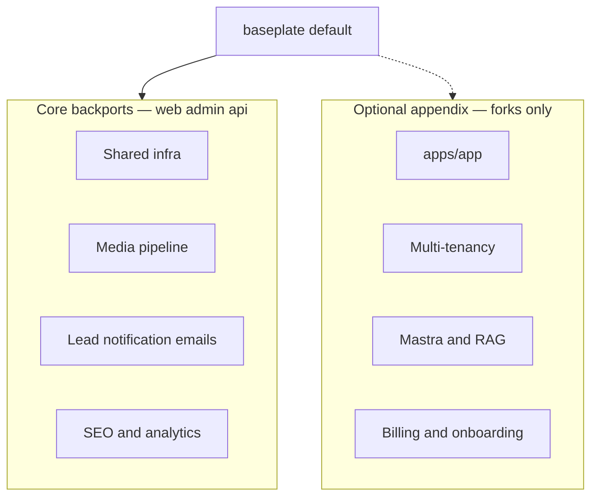

# Baseplate Backport Investigation

> **Date:** 2026-06-28 (refined)  
> **Baseline:** `default` @ `19b2cc1` — marketing + admin + API starter  
> **Sources:** `thesmileartist-mono`, `dealyze-proto` (learnings only — not a workspace fork)  
> **Scope:** Generic improvements to **web, admin, and api** — the three apps baseplate ships today.

---

## Scope principles

Baseplate is a **marketing site + admin dashboard + API** starter. Forks like dealyze-proto and thesmileartist-mono extend it with domain-specific product surfaces; baseplate itself should stay lean.

| In scope (core) | Deferred (optional appendix) |
|-----------------|--------------------------------|
| `apps/web` marketing improvements | `apps/app` workspace shell |
| `apps/admin` CRM/content/ops improvements | Organization plugin, invitations, switcher |
| `apps/api` shared backend hardening | User API, user notifications |
| Dev/prod infra for the three apps | Chroma, Mastra, assistant chat |
| Media pipeline, lead emails, SEO | Polar billing, onboarding tour, Tavily |

**Rule:** Port generic patterns from downstream repos; strip all domain fields. Do not expand baseplate's product surface unless explicitly opting into the appendix.

**`main` branch:** Polluted with accidental Dealyze work — not a backport source. Rebuild `main` from `default` + core backports below.

---

## Baseline (unchanged)

| Present | Not in scope for core |
|---------|----------------------|
| `apps/web`, `apps/admin`, `apps/api` | `apps/app` |
| Better Auth (admin + twoFactor) | Organization plugin |
| Leads, contacts, blog, media | `/api/user/*` |
| Admin notifications + SSE | Chroma, Mastra |
| BullMQ + S3/MinIO | User notifications |
| Migrations `0000`–`0011` | |

---

## A. Core — shared infrastructure

Improvements that benefit all three apps or the operator workflow. Sourced from both forks unless noted.

| Item | Source | Why core |
|------|--------|----------|
| **`@repo/client-api` package** | dealyze | Admin fetch/auth helpers duplicated; dev proxy breaks without `VITE_API_URL` |
| **MinIO init + healthcheck** | dealyze | First-run dev experience for media/blog uploads |
| **Bull Board (dev-only)** | dealyze | Debug email/notification/event jobs locally |
| **Worker stalled-job logging** | thesmileartist | Ops visibility for background jobs |
| **API noindex middleware** | thesmileartist | API should not appear in search results |
| **Remove API root placeholder** | thesmileartist | No indexable `GET /` placeholder page |
| **API app integration test** | thesmileartist | Lock in noindex + root 404 behavior |
| **Production Docker hardening** | both | Split web/admin nginx; minio-public noindex proxy; worker S3 env for image jobs; internal network aliases |
| **`.cursor/rules/drizzle-migrations.mdc`** | dealyze | Agent guardrail for schema workflow |
| **`docs/DEPLOY.md`** | dealyze | Production guide beyond `DOKPLOY.md` |
| **Categorized `.env.example`** | both | API, admin, web env docs (GA, MinIO, worker concurrency) |
| **Doc reconciliation** | baseplate | README, Spec, API README match starter scope |

**Not core from dealyze:** `WORKSPACE_APP_ORIGIN`, Chroma/OpenAI turbo vars, Google auth env — add only if optional appendix is adopted.

---

## B. Core — admin media pipeline

From thesmileartist-mono. Directly improves the admin media library, blog covers, and profile avatars baseplate already has.

| Layer | What |
|-------|------|
| API | Sharp WebP processing, S3 buffer helpers, `images` queue + worker, auto-dispatch on finalize |
| Schema | `processingStatus`, `processingError`, `processedAt` on `media_asset` |
| Types | Processing fields + bulk delete schemas |
| Admin UI | Processing badges, polling refetch, bulk delete, media picker `excludeIds` |
| Config | `IMAGE_WORKER_CONCURRENCY`, `--external sharp` |
| Tests | Image processing unit tests |

**ADR:** Media processing lifecycle.

---

## C. Core — lead notification emails

From thesmileartist-mono. Extends existing `lead.created` → admin notification flow.

| Layer | What |
|-------|------|
| Schema | `admin_notification_email_recipient` table |
| API | Email job + generic template (no dental lead fields); settings CRUD routes |
| Admin UI | Manage notification recipients in settings |
| Events | Dispatch email in parallel with in-app notification |

Baseplate lead schema is already simpler (name, email, phone, message, source, status, priority) — template maps cleanly.

---

## D. Core — marketing site toolkit

From thesmileartist-mono. Improves `apps/web` without adding domain routes.

| Item | Backport |
|------|----------|
| `siteConfig` + `createSeoHead()` | Yes — parameterized for forks |
| Generic JSON-LD (breadcrumb, FAQ) | Yes — skip dental schemas |
| Google Analytics + `VITE_GA_MEASUREMENT_ID` | Yes |
| `HeadContent` + per-route `head()` | Yes |
| Template `robots.txt`, `sitemap.xml` | Yes |
| `SiteHeader`, `SiteFooter`, `site-nav.ts` | Yes — hash-aware nav helper |
| `apps/web/.env.example` | Yes |
| Privacy/terms page **templates** | Optional — useful starter copy to customize |
| `PageHero`, `MotionCarousel`, social icons | Optional polish — adds `motion` dep |

**Skip:** dental service routes, gallery CMS, clinic-specific JSON-LD, homepage CMS.

---

## E. Core — admin patterns (no new product surface)

| Item | Source | Notes |
|------|--------|-------|
| Migrate admin to `@repo/client-api` | dealyze | Part of shared infra slice |
| Keep `@repo/ui` imports | baseplate | Do **not** adopt smile's admin-local shadcn vendoring |

Admin assistant chat widget is **not core** — requires Mastra (optional appendix).

---

## F. Optional appendix — workspace platform

Adopt only when a fork needs an authenticated end-user app (e.g. dealyze). Not required to improve the marketing + admin starter.

| Item | Source | Notes |
|------|--------|-------|
| `apps/app` workspace shell | dealyze | Port 5200 SPA: auth, settings hub, dashboard stub |
| Organization plugin | dealyze | Personal org provision, ADR 0001 |
| Org invitations + switcher | dealyze | Email job, accept route, sidebar switcher |
| User profile + notifications API | dealyze | Generic notification types only |
| Google OAuth + auth UI components | dealyze | Workspace sign-in |
| Dockerfile `app` target + compose service | dealyze | Extends production Docker from core Phase 2 |

---

## G. Optional appendix — AI / assistant

Adopt only when a fork needs LLM features. Not required for CRM/blog/media marketing starter.

| Item | Source | Notes |
|------|--------|-------|
| Chroma Sync RAG | dealyze | ADR 0003 pattern |
| Mastra + multi-session chat | dealyze | Generic admin assistant; skip property/email agents |
| Admin assistant chat widget | dealyze | Depends on Mastra |
| `@repo/ui` assistant-markdown | dealyze | Shared chat renderer |
| Tavily web search | dealyze | Opt-in tool when API key set |

---

## H. Optional appendix — monetization & onboarding

| Item | Source | Notes |
|------|--------|-------|
| Polar billing module | dealyze | Env-gated; ADRs 0022/0023 as opt-in |
| Driver.js onboarding tour | dealyze | Fork-customizable steps |
| Rate-limit `skip` for webhooks | dealyze | Pairs with billing |
| `token-encryption.ts` | dealyze | OAuth token storage if needed |

---

## I. Already in baseplate (do not re-port)

- Better Auth admin + twoFactor + password reset
- CRM: leads, contacts, blog, media (basic)
- Admin notifications + SSE, activity audit
- Manager role, domain events for `lead.created`
- `@repo/ui` shared package strategy
- CI pipeline, Windsurf workflows, admin react-query cursor rule

---

## J. Explicitly out of scope (domain-specific)

**From dealyze:** Gmail, email analysis, vendors, legal entities, property hierarchy, workspace delegation.

**From thesmileartist:** patients, providers, schedule, gallery CMS, before-after composer, dental lead fields, dental JSON-LD.

---

## K. Mapping to `FEATURE_IDEAS.md`

| FEATURE_IDEAS item | Core backport | Optional appendix |
|--------------------|---------------|-------------------|
| §3 Env/config system | `.env.example`, DEPLOY docs | Chroma/billing vars if adopted |
| §1 Testing | `app.test.ts`, image processing tests | Chat/RAG test fixtures |
| §12 Starter branding | `siteConfig`, `site-nav.ts` | — |
| §9 Multi-Tenancy | — | Org plugin + workspace shell |
| §6 OpenAPI | Still open | — |

---

## L. Core phase plan

### Phase 0 — Docs and guardrails
- Reconcile README, Spec, API README for web/admin/api scope
- `docs/DEPLOY.md`, drizzle-migrations cursor rule

### Phase 1 — Dev ergonomics and DRY
- `@repo/client-api` + admin migration
- MinIO init, Bull Board, worker stalled logging
- API noindex + remove root placeholder + test

### Phase 2 — Production hardening
- Split nginx, minio-public proxy, worker S3 env
- Complete `.env.example` files (api, admin, web)

### Phase 3 — Admin media pipeline
- WebP optimization end-to-end (schema change)

### Phase 4 — Lead notification emails
- Recipients table, email job, settings UI (schema change)

### Phase 5 — Marketing site toolkit
- SEO, GA, robots/sitemap, site layout extraction

---

## M. Optional appendix phases (when a fork needs them)

- **A1** — Organization plugin foundation  
- **A2** — `apps/app` workspace shell + production compose extension  
- **A3** — Invitations, switcher, user notifications  
- **A4** — Chroma Sync RAG infrastructure  
- **A5** — Mastra + admin assistant widget  
- **A6** — Google OAuth, billing, onboarding, Tavily (pick per fork)

---

## N. Docs to create (core only)

- **ADR:** Media processing lifecycle (Phase 3)
- **ADR:** Lead notification email recipients (Phase 4)
- **CONTEXT.md:** Add terms only if optional appendix is adopted (Organization, Workspace, Assistant)
- **`FEATURE_IDEAS.md`:** Mark §3, §12, §1 items addressed as phases land

---

## O. Backport checklist

1. Strip domain fields from downstream code
2. Schema: edit `schema.ts` only; Steve runs migrations
3. Add tests; update docs and `.env.example`
4. Verify improvement applies to web/admin/api — if it requires `apps/app`, it belongs in the optional appendix

---

## P. Summary

The first investigation over-scoped baseplate by treating dealyze's workspace platform as core. **This revision keeps baseplate a marketing + admin starter** and concentrates on what both forks proved valuable for that shape: infra hardening, media processing, lead emails, and marketing SEO.

Dealyze learnings still matter for **admin and api** (`client-api`, Bull Board, minio-init, DEPLOY docs). Thesmileartist learnings dominate **web and admin media**. Workspace, multi-tenancy, and Mastra move to an optional appendix for forks that need them — not for rebuilding baseplate `main`.

See [`BACKPORT-ISSUES.md`](./BACKPORT-ISSUES.md) for vertical-slice issues aligned to this scope.
