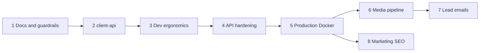
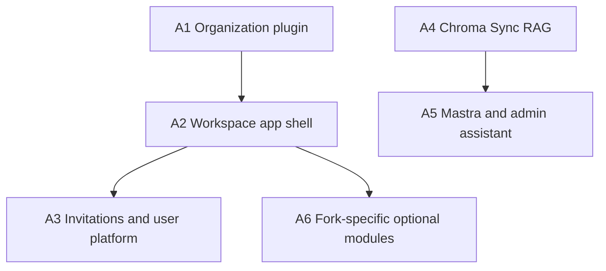

# Baseplate Backport Issues

> **Source:** [`docs/BACKPORT-INVESTIGATION.md`](./BACKPORT-INVESTIGATION.md) (refined 2026-06-28)  
> **Scope:** Core issues improve **web, admin, api** only. Optional appendix issues are for forks that need workspace or AI features.

---

## Core issues — suggested order

**Grab order:** 1 → 2 → 3 → 4 → 5 → 6 → 7 → 8 (Phase 5 marketing can parallel Phase 3–4 after Issue 5)

---

## Issue 1 — Platform docs and agent guardrails

**Blocked by:** None

### What to build

Align documentation with the marketing + admin + API starter scope. Add `.cursor/rules/drizzle-migrations.mdc`. Add `docs/DEPLOY.md` for web/admin/api production topology. Update `README.md`, `Spec.md`, and `apps/api/README.md` — describe what ships today, not workspace or AI features.

### Acceptance criteria

- [ ] Drizzle migrations cursor rule exists
- [ ] `docs/DEPLOY.md` covers api, worker, web, admin, postgres, redis, minio
- [ ] README and API README accurate for starter scope
- [ ] No references to unshipped apps/app or Mastra as if they exist

---

## Issue 2 — Extract `@repo/client-api` and migrate admin

**Blocked by:** None

### What to build

Shared package for API URL resolution (dev-proxy fallback), JSON client, and auth client factory. Migrate `apps/admin` off inline fetch helpers.

### Acceptance criteria

- [ ] `packages/client-api` wired in monorepo
- [ ] Admin works without `VITE_API_URL` in local dev
- [ ] CI typecheck passes; admin login + one API fetch smoke-tested

---

## Issue 3 — Local dev stack ergonomics

**Blocked by:** None

### What to build

MinIO bucket bootstrap on dev compose up. Bull Board at `/admin/queues` (dev-only). Worker stalled-job logging.

### Acceptance criteria

- [ ] S3 bucket auto-created on first compose up
- [ ] Bull Board available in dev, absent in production
- [ ] Stalled jobs log warnings
- [ ] Documented in API README

---

## Issue 4 — API search-engine hardening

**Blocked by:** None

### What to build

Global noindex middleware on all API responses. Remove root placeholder route. Integration tests for headers and 404.

### Acceptance criteria

- [ ] `X-Robots-Tag: noindex, nofollow, noarchive` on all responses
- [ ] `GET /` returns 404
- [ ] `app.test.ts` passes in CI

---

## Issue 5 — Production Docker and nginx hardening

**Blocked by:** None

### What to build

Split web/admin nginx configs. MinIO public proxy with search blocking. Internal app-network aliases. Worker S3 credentials + minio dependency (needed for image jobs). GA build arg for web (optional, no-op when unset). Complete `apps/web/.env.example`.

### Acceptance criteria

- [ ] Separate web and admin nginx configs
- [ ] MinIO public proxy blocks indexing
- [ ] Worker has S3 env in prod compose
- [ ] Web `.env.example` documents GA measurement ID

---

## Issue 6 — Media asset WebP optimization pipeline

**Blocked by:** Issue 5 (worker S3 env in prod) — soft; can start after Issue 3  
**Schema:** Steve runs migrations

### What to build

Full image optimization slice from thesmileartist: Sharp processing, images queue/worker, schema lifecycle fields, types, auto-dispatch on media/blog/avatar finalize, admin UI with polling and bulk delete, media picker excludeIds, tests.

### Acceptance criteria

- [ ] Uploads show processing → ready/failed in admin
- [ ] Bulk delete works
- [ ] Blog cover and avatar uploads trigger optimization
- [ ] Unit tests pass
- [ ] ADR for media processing lifecycle

---

## Issue 7 — Lead notification emails with configurable recipients

**Blocked by:** None — soft overlap with Issue 6 admin settings patterns  
**Schema:** Steve runs migrations

### What to build

Email configured admins when leads are created. Recipient CRUD in settings. Generic template matching baseplate lead fields.

### Acceptance criteria

- [ ] Lead creation emails configured recipients
- [ ] Settings UI for add/remove recipients
- [ ] In-app notification still works when recipient list empty
- [ ] No dental-specific lead fields in template

---

## Issue 8 — Marketing site SEO and analytics foundation

**Blocked by:** Issue 5 (GA build arg) — soft; can start anytime

### What to build

SEO utilities, siteConfig, HeadContent, GA page-view tracking, robots/sitemap templates, extracted site header/footer/nav. Skip motion-heavy components unless wanted.

### Acceptance criteria

- [ ] Per-route meta via TanStack Router head
- [ ] GA tracks navigation when measurement ID set
- [ ] robots.txt and sitemap.xml templates exist
- [ ] Site layout extracted from root route

---

## Core quick reference

| # | Title | Blocked by | Schema? |
|---|-------|------------|---------|
| 1 | Docs and guardrails | — | No |
| 2 | `@repo/client-api` | — | No |
| 3 | Dev ergonomics | — | No |
| 4 | API hardening | — | No |
| 5 | Production Docker | — | No |
| 6 | Media WebP pipeline | 5 soft | Yes |
| 7 | Lead notification emails | — | Yes |
| 8 | Marketing SEO and analytics | 5 soft | No |

---

# Optional appendix issues

For forks (e.g. dealyze-proto) that need workspace or AI — **not required** to rebuild baseplate `main`.

---

## Issue A1 — Organization plugin foundation (optional)

**Blocked by:** None  
**Schema:** Yes

### What to build

Better Auth organization plugin, personal org auto-provision, org access helpers, ADR 0001.

### Acceptance criteria

- [ ] Personal org created on user sign-up
- [ ] Org access helpers available for downstream routes

---

## Issue A2 — Workspace app shell (optional)

**Blocked by:** A1, Issue 2 (client-api)

### What to build

`apps/app` on port 5200: auth, settings hub skeleton, dashboard stub. Docker app target + prod compose service. No domain routes.

### Acceptance criteria

- [ ] Workspace app runs locally with dev proxy
- [ ] User sign-up/sign-in/sign-out works
- [ ] Production Docker extended with app service

---

## Issue A3 — Invitations, switcher, and user notifications (optional)

**Blocked by:** A1, A2

### What to build

Invitation email flow, accept route, org switcher, org settings card, user profile + notification API + bell (generic types).

### Acceptance criteria

- [ ] End-to-end invite and accept flow
- [ ] Org switcher invalidates scoped queries
- [ ] User notification bell with SSE

---

## Issue A4 — Chroma Sync RAG platform (optional)

**Blocked by:** A1 soft

### What to build

Chroma client/sync/search, indexing job on ai queue, readiness checks, ADR 0003. Infrastructure only — domain indexing wired by fork.

### Acceptance criteria

- [ ] Indexing job processes test documents when Chroma configured
- [ ] Graceful skip when Chroma unset

---

## Issue A5 — Mastra and admin assistant (optional)

**Blocked by:** A4 soft (admin-only chat could skip RAG)

### What to build

Mastra setup, generic admin-assistant agent, multi-session chat API, teed stream, assistant-markdown in ui, admin chat widget.

### Acceptance criteria

- [ ] Admin assistant widget streams responses
- [ ] Multiple chat sessions supported
- [ ] No property/email-specific agents

---

## Issue A6 — Fork-specific optional modules (optional)

**Blocked by:** Varies

Pick per fork:

| Module | Source | Blocked by |
|--------|--------|------------|
| Google OAuth + auth UI | dealyze | A2 |
| Polar billing | dealyze | A1, A2, A3 |
| Onboarding tour | dealyze | A2 |
| Tavily web search | dealyze | A5 |

---

## Notes

- **Core = 8 issues** to rebuild baseplate `main` as a stronger marketing + admin starter.
- **Appendix = 6 issue groups** for forks that grow beyond that shape.
- Schema changes: Steve runs `db:generate` / `db:migrate` from `apps/api`.
